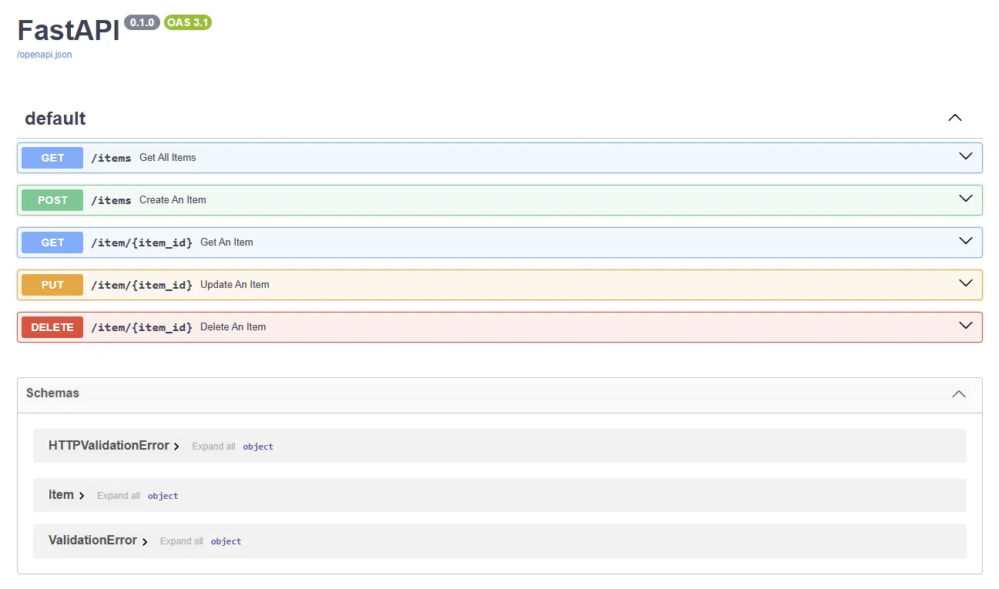
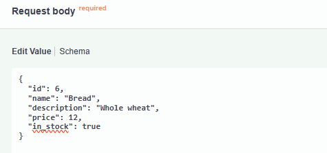
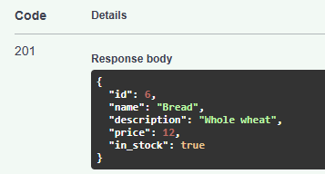
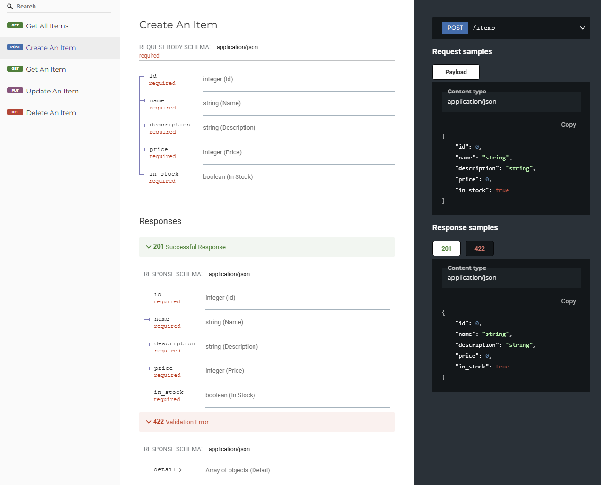

# ItemVault

A RESTful CRUD API template for managing store items, built with **FastAPI**, **PostgreSQL**, and **SQLAlchemy**. I built it as a learning project to get hands-on with FastAPI's request/response model, Pydantic validation, and relational database access from Python.

## Features

- Full CRUD for store items
- PostgreSQL storage
- Automatic request validation with clear `422` errors
- Duplicate prevention (`400`) and `404` on delete for missing items

## Tech Stack

| Layer | Technology |
|---|---|
| Framework | FastAPI |
| Validation | Pydantic V2 |
| ORM | SQLAlchemy |
| Database | PostgreSQL |
| Server | Uvicorn |
| Language | Python |

## API Documentation

### Screenshots

**Swagger UI**



**Example request and response**

 

**ReDoc**



## Endpoints

| Method | Path | Description | Success | Errors |
|---|---|---|---|---|
| `GET` | `/items` | List all items | `200` | |
| `GET` | `/item/{item_id}` | Get one item by ID | `200` | `404` not found |
| `POST` | `/items` | Create an item | `201` | `400` item already exists |
| `PUT` | `/item/{item_id}` | Update an item | `200` | `404` not found |
| `DELETE` | `/item/{item_id}` | Delete an item | `200` | `404` not found |

### Item model

```json
{
  "id": 1,
  "name": "Mechanical Keyboard",
  "description": "75% layout, hot-swappable switches",
  "price": 120,
  "in_stock": true
}
```

### Example: create an item

```bash
curl -X POST http://127.0.0.1:8000/items \
  -H "Content-Type: application/json" \
  -d '{"name": "Mechanical Keyboard", "description": "75% layout, hot-swappable switches", "price": 120, "in_stock": true}'
```

Response (`201 Created`):

```json
{
  "id": 1,
  "name": "Mechanical Keyboard",
  "description": "75% layout, hot-swappable switches",
  "price": 120,
  "in_stock": true
}
```

## Project Structure

```
.
├── main.py        # FastAPI app and route handlers
├── models.py      # SQLAlchemy models (database tables)
├── schemas.py     # Pydantic schemas (request/response validation)
├── database.py    # Engine and session setup
├── requirements.txt
└── README.md
```

## What I Learned

- Designing REST endpoints and choosing correct HTTP status codes
- Using Pydantic V2 for validation to serialize ORM objects
- Separating models (storage) from schemas (API contract)
- Querying PostgreSQL through SQLAlchemy sessions
- Reading auto-generated OpenAPI docs to test and document an API

## Possible Future Improvements

### Known limitation in the current code
- **Per-request database sessions.** All requests share one module-level session. A `get_db` dependency with `Depends` would give each request its own session and close it afterward.

### Next steps
- Add automated tests with `pytest` and FastAPI's `TestClient`, using a separate test database
- Dockerize the app and PostgreSQL with Docker Compose
- Add a CI pipeline (GitHub Actions) to run the tests on every push
- Add pagination and filtering to `GET /items`
- Add user authentication
